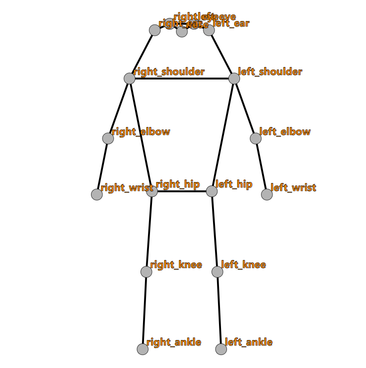
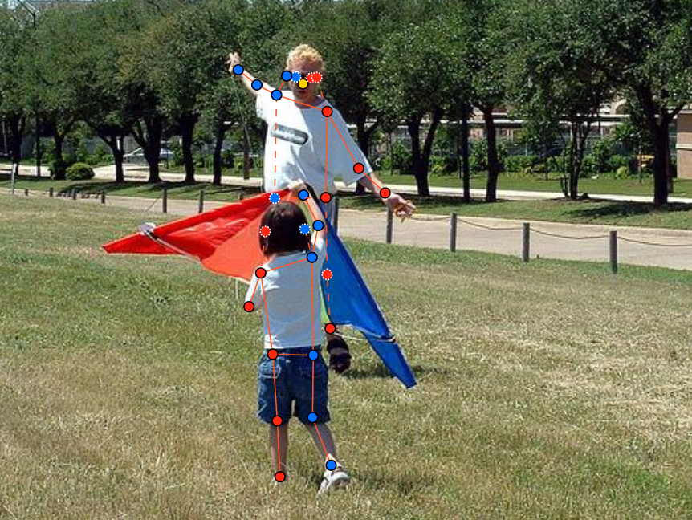
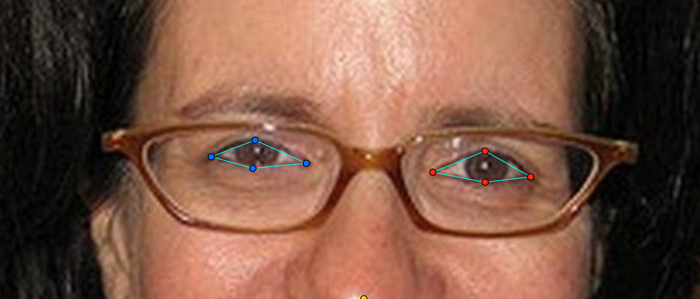
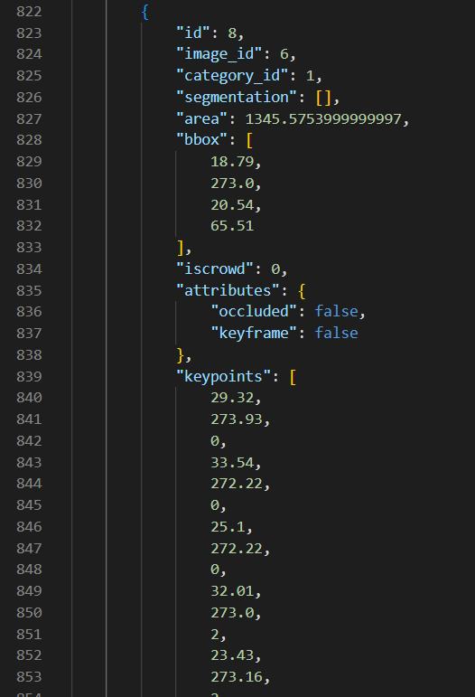
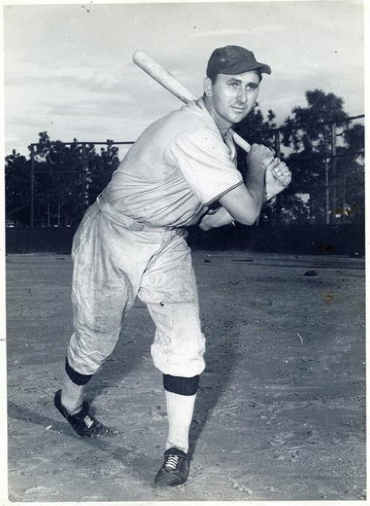

# Báo cáo cá nhân — Ngô Xuân Tùng - 2A202603225

Đổi tên file theo quy tắc `MSSV_HoTen.md`. Ví dụ: `20241234_NguyenVanAn.md`.

Dữ liệu: 12 ảnh người COCO val2017 (Lin et al., 2014) và 8 ảnh chân dung Wikimedia Commons, chỉ dùng trong lớp.

## 0. Thông tin học viên

- Họ tên: Ngô Xuân Tùng
- MSSV: 2A202603225
- Email: 26ai.tungnx2@vinuni.edu.vn
- Link repository: 
- Phiên bản CVAT (Help → About): 2.74.1
- Máy: hệ điều hành Window · RAM 32 GB · chạy CVAT chế độ đầy đủ.
- Bộ ảnh (`src/exports/assignment.json` do `lab.py setup` tạo): Có
- Giờ bắt đầu: 17h00
- Giờ kết thúc: 19h00

## 1. Kiểm tra label (CP0)

| Label | Kiểu | Số điểm | Tên điểm đúng bảng của lab? | Đúng thứ tự? | Số cạnh |
|---|---|---:|---|---|---:|
| `person` | Skeleton | 17 | Đúng | Đúng | 19 |
| `face` | Skeleton | 13 | Đúng | Đúng | 13 |

Mẫu `person` dựng theo người quay mặt về camera (các điểm `left_*` nằm bên phải khung mẫu)? Có

Cách đổi cờ `occluded` / `outside` cho **một điểm** trên phiên bản CVAT này (một câu):

Rê chuột vào đúng điểm cần đổi (điểm sáng lên), bấm phím `Q` để bật/tắt `occluded` hoặc phím `O` để bật/tắt `outside` (hoặc nhấp chuột phải vào điểm để chọn cờ tương ứng).

## 2. Số lượng đã gán và thời gian (CP1, CP2)

| Nhóm ảnh | Số ảnh | Số skeleton đã gán | Số người dưới 60 px (không gán) | Số poster / gương / màn hình bỏ qua | Thời gian (phút) |
|---|---:|---:|---:|---:|---:|
| `easy` | 5 | 5 | 0 | 0 | 15 |
| `occluded` | 3 | 4 | 0 | 0 | 20 |
| `back` | 2 | 3 | 0 | 0 | 10 |
| `small` | 1 | 2 | 2 | 0 | 8 |
| `crowd` | 1 | 3 | 3 | 0 | 12 |
| `faces` | 8 | 8 | 0 | 0 | 15 |

- Số ảnh người đã xong ở mốc phút 105: 10 / 10
- Thời gian thực tế (phút): CP1 65 · CP2 15 · CP3 15
- Ảnh tốn thời gian nhất là ảnh nào, vì sao?

Ảnh tốn thời gian nhất là ảnh đám đông `000000381889.jpg` (nhóm `crowd`) và ảnh người ở xa `000000167027.jpg` (nhóm `small`). Với ảnh đám đông, các nhân vật đứng gần nhau và các chi bị che khuất đan xen, cần lần cẩn thận theo từng khớp xương từ vai/hông để không nối nhầm chi của người này sang người kia. Với ảnh người nhỏ (small), người ở xa có độ phân giải thấp và bị vỡ hạt khi phóng to, cần phải đo đạc kỹ để xác định người cao trên/dưới 60 px cũng như zoom tối đa để căn chỉnh chuẩn xác các khớp nhỏ như mắt, mũi, cổ tay, cổ chân.

## 3. Bảng ca khó (CP1, CP2)

Mỗi điểm bạn phân vân một dòng, nhất là phân vân giữa `v = 1` và `v = 0`, hoặc không chắc hướng người.

| Ảnh | Người / mặt | Điểm | Cờ đã chọn | Phân vân giữa | Lý do chọn |
|---|---|---|---:|---|---|
| `000000091637.jpg` | Đứa trẻ (quay lưng) | `left_ear` | 1 | `v = 1` và `v = 0` | Đứa trẻ quay lưng lại camera, tóc che kín tai trái. Phân vân giữa `v = 0` (bị che khuất) và `v = 1` (ước lượng được). Quyết định chọn `v = 1` (`occluded`) vì hình dạng hộp sọ và đường viền tóc rõ ràng, có thể ước lượng chắc chắn vị trí giải phẫu của tai trái. |
| `000000091637.jpg` | Đứa trẻ (quay lưng) | `right_ear` | 1 | `v = 1` và `v = 0` | Tương tự tai trái, tai phải bị tóc che khuất nhưng dựa vào tính đối xứng của đầu và hướng xoay của cơ thể, vị trí tai phải hoàn toàn có thể xác định tin cậy nên chọn `v = 1`. |
| `000000091637.jpg` | Người lớn (phía sau) | `right_knee` | 0 | `v = 1` và `v = 0` | Chân phải bị cánh diều lớn màu xanh che khuất hoàn toàn từ đùi trở xuống; tư thế đứng khuất góc không thể ước lượng chắc chắn khớp gối, quyết định chọn `v = 0` (`outside`) theo quy tắc "không đoán bừa". |

## 4. Bảng tự review (CP3)

Đi từ ảnh cuối về ảnh đầu. 5 ảnh người (ít nhất 2 ảnh `back` hoặc `crowd`) và 3 ảnh mặt. Ít nhất 8 dòng, kể cả dòng `ok`. Ghi lỗi trước, sửa sau.

Mã lỗi dùng đúng một trong: `lr_swap`, `vis_flag`, `position`, `missing`, `extra`, `ok`.

| Ảnh | Người / mặt | Điểm | Mã lỗi | Ghi chú | Đã sửa? |
|---|---|---|---|---|---|
| `000000381889.jpg` | Đám đông (3 người) | Toàn bộ | `ok` | Đã kiểm tra 3 người, đường nối các chi độc lập, không bắt chéo chi, cờ v đặt chuẩn | — |
| `000000167027.jpg` | Người ở xa (small) | Toàn bộ | `ok` | Khớp vị trí chi thể chuẩn dù ảnh vỡ hạt, người < 60 px đã bỏ qua đúng quy định | — |
| `000000307757.jpg` | Người quay lưng | Toàn bộ cặp L/R | `lr_swap` | Ban đầu gán nhầm bên trái và phải theo góc nhìn camera; đã hoán đổi lại đúng quy ước cơ thể người | Có |
| `000000164659.jpg` | Người quay mặt | `left_knee`, `right_knee`, `left_ankle`, `right_ankle` | `lr_swap` | Người quay mặt về camera nhưng chân bước vắt chéo, ban đầu không quan sát kỹ nên nhầm L/R ở gối và cổ chân; đã kiểm tra và hoán đổi lại đúng bên | Có |
| `000000019754.jpg` | Vận động viên lướt ván | Toàn bộ | `ok` | Tư thế nhảy bắt ván (board grab) trên không: tay trái đưa ra trước thăng bằng, tay phải với nắm mép ván; các điểm khớp chân sau ván đều đặt cờ v=1 chuẩn xác | — |
| `face_483667.jpg` | Khuôn mặt (tóc che) | `left_eye_upper`, `left_eye_outer` | `vis_flag` | Tóc mái che mí trên và khóe ngoài mắt trái; ban đầu để v=2 theo mẫu, sau rà soát đã đổi sang `occluded` (v=1) ước lượng chắc theo mắt | Có |
| `face_442231.jpg` | Khuôn mặt (mặt nghiêng, ăn pizza) | `mouth_left`, `mouth_right`, `lip_upper`, `lip_lower` | `position` | Miệng chu lại khi ăn pizza làm lệch vị trí môi; ban đầu chấm theo khung mẫu bị lệch mép môi, sau phóng to đã chỉnh đúng góc khóe và viền môi | Có |
| `face_405456.jpg` | Khuôn mặt (kính râm) | 8 điểm của 2 mắt (`*_eye_*`) | `ok` | Đã rà soát đủ 8 điểm mắt sau tròng kính râm tối màu đều được đặt cờ `occluded` (v=1) chuẩn xác theo viền gọng kính, mũi miệng v=2 đúng chỗ | — |

Tổng hợp số lỗi theo mã:

| `lr_swap` | `vis_flag` | `position` | `missing` | `extra` | `ok` |
|---:|---:|---:|---:|---:|---:|
| 2 | 1 | 1 | 0 | 0 | 4 |

Điểm còn phân vân giữa `v = 1` và `v = 0` (ghi cả hai lựa chọn và lý do chọn):

Điểm tai trái và tai phải (`left_ear`, `right_ear`) của đứa trẻ quay lưng trong ảnh `000000091637.jpg`: Phân vân giữa `v = 0` (bị tóc che khuất) và `v = 1` (ước lượng được). Quyết định chọn `v = 1` vì hình dạng hộp sọ và đường viền tóc rõ ràng, hoàn toàn ước lượng chắc chắn được vị trí giải phẫu đối xứng của hai tai.

## 5. Kiểm file xuất và kết quả tự kiểm (CP4)

Tự kiểm tay trong file JSON:

| File | Người / mặt kiểm (ảnh, thứ tự) | Số phần tử `keypoints` | Điểm `outside` ra `v = 0`, `occluded` ra `v = 1`? | `num_keypoints` khớp? |
|---|---|---:|---|---|
| `NgoXuanTung_persons.zip` | `000000019754.jpg`, người #1 | 51 | Đúng (`v = 1`: 4 điểm, `v = 2`: 13 điểm, `v = 0`: 0) | Khớp (17) |
| `NgoXuanTung_persons.zip` | `000000043719.jpg`, người #1 | 51 | Đúng (`v = 0`: 8 điểm ngoài ảnh, `v = 2`: 9 điểm) | Khớp (9) |
| `NgoXuanTung_faces.zip` | `face_483667.jpg`, mặt #1 | 39 | Đúng (`v = 1`: 2 điểm tóc che, `v = 2`: 11 điểm) | Khớp (13) |

Sau khi xuất, CVAT ghi `occluded` thành `v = 1` và `outside` thành `v = 0`. Tọa độ của điểm `outside` trong file là `0, 0` hay tọa độ cũ? Tọa độ cũ

Hai job đã chuyển sang completed trên CVAT? Có

Dán phần **TÓM TẮT** in ra từ `src/check_submission.py`:

```text
----- TÓM TẮT (dán vào báo cáo mục 5) -----
- File person: NgoXuanTung_persons.zip
  Số ảnh: 12 · số skeleton `person`: 17 · mỗi annotation 51 số
  Skeleton theo ảnh: 000000019754=1, 000000043719=1, 000000057978=1, 000000091637=2, 000000164659=1, 000000167027=2, 000000189365=1, 000000220045=1, 000000292999=1, 000000294329=1, 000000307757=2, 000000381889=3
  Cờ v: v=2 197 (68%) · v=1 32 (11%) · v=0 60 (21%)
  num_keypoints trung bình: 13.5
- File face: NgoXuanTung_faces.zip
  Số ảnh: 8 · số skeleton `face`: 8 · mỗi annotation 39 số
  Skeleton theo ảnh: face_143959=1, face_145751=1, face_300399=1, face_356144=1, face_405456=1, face_442231=1, face_483667=1, face_575921=1
  Cờ v: v=2 94 (90%) · v=1 10 (10%) · v=0 0 (0%)
  num_keypoints trung bình: 13.0
- Ghi chú: 60 điểm v = 0 vẫn mang tọa độ cũ (CVAT 2.x xuất như vậy; chuẩn COCO ghi 0, 0). Không phải lỗi: điểm v = 0 bị bỏ qua khi huấn luyện và khi chấm.
- Số [LỖI]: 0 · số [CẢNH BÁO]: 3
Kết quả: ĐẠT (đọc lại từng cảnh báo ở trên)
```

Các `[CẢNH BÁO]` còn giữ nguyên và lý do:

Script in ra 3 cảnh báo về việc các cặp điểm nằm ngược phía (cảnh báo khả năng `lr_swap` hoặc tay/chân bắt chéo thật):
1. `000000019754.jpg #1` (cặp wrist): Vận động viên đang thực hiện cú nhảy trên không với ván trượt trong tư thế co người bắt ván (board grab); tay trái đưa ra trước giữ thăng bằng trong khi tay phải duỗi sâu xuống phía dưới để nắm mép ván, thân người gập nghiêng mạnh khiến vị trí tương đối của hai cổ tay lệch so với trục cơ thể chuẩn. Các điểm cổ tay trái và phải đã được kiểm tra kỹ và đặt hoàn toàn chính xác theo đúng giải phẫu thực tế của động tác thể thao.
2. `000000164659.jpg #1` (cặp knee, ankle): Người trong ảnh đang sải bước chân vắt chéo nhau khi di chuyển, chân phải bước chéo sang bên trái người xem và ngược lại. Đã rà soát và xác nhận các điểm gối, cổ chân đặt hoàn toàn chuẩn xác theo người thật.
3. `000000292999.jpg #1` (cặp elbow): Cầu thủ bóng chày đang ở tư thế giương gậy chuẩn bị đập bóng (batting stance); hai tay cùng giơ cao nắm gậy khiến cánh tay phải vòng qua trước ngực, đẩy khuỷu tay phải (`right_elbow`) chếch ra phía ngoài (sang bên phải ảnh), trong khi khuỷu tay trái (`left_elbow`) co gập sát thân người. Tư thế này làm tọa độ X của khuỷu tay phải lớn hơn khuỷu tay trái, ngược với hướng của các cặp vai/hông/chân. Đã kiểm tra kỹ và khẳng định đây là đặc thù giải phẫu chuẩn của động tác cầm gậy bóng chày chứ không phải do gán nhầm trái/phải.

## 6. Ảnh chụp màn hình

1. Label `person` trong label constructor (đủ 17 điểm có tên):

   

2. Một người quay lưng đã gán, cờ đã đặt:

   

3. Một khuôn mặt đã gán 13 điểm, phóng to vùng mắt:

   

4. Một đoạn JSON xuất của một người:

   

Nguồn ảnh: COCO val2017 / Wikimedia Commons.

## 7. Tự đánh giá

1. Lỗi bạn mắc nhiều nhất hôm nay, và cách bạn sẽ tránh ở dự án thật:

   Lỗi mắc nhiều nhất là `lr_swap` — gán nhầm trái/phải. Lỗi này xuất hiện ở 2 trường hợp rất khác nhau: ảnh người quay lưng (`000000307757.jpg`) do quên đảo các cặp điểm `left_*`/`right_*` trước khi tinh chỉnh, và ảnh người bước đi vắt chân (`000000164659.jpg`) do bị đánh lừa bởi vị trí chân trong ảnh thay vì xác định theo giải phẫu cơ thể người. Ở dự án thật, tôi sẽ thiết lập **checklist xác nhận hướng người ngay trong tool** trước khi bắt đầu kéo điểm: ghi nhận hướng vào trường comment/tag của annotation (ví dụ `facing: back`, `facing: front`) để buộc bản thân dừng lại và đánh giá có chủ ý thay vì gán theo quán tính. Sau khi gán xong một người, sẽ dành 3–5 giây **lướt nhanh theo đường nối xương trực quan**: nếu thấy hai chân hoặc hai tay bắt chéo bất thường là dừng kiểm tra trái/phải ngay thay vì chuyển sang annotation tiếp theo. Với dự án quy mô lớn, nên bật tính năng **review pass tự động** (như script `check_submission.py`) sau mỗi batch để bắt lỗi `lr_swap` sớm nhất có thể.

2. Một quy tắc bạn đề xuất thêm vào guideline (kèm ảnh ví dụ nếu có):

   **Quy tắc đề xuất: Phân biệt tư thế thể thao theo "điểm neo" trước khi xác định trái/phải.**

   Với người đang thực hiện động tác thể thao phức tạp (cầm gậy bóng chày, lướt ván, đá bóng…), các chi thường vắt chéo hoặc lệch hẳn so với trục thân mình, khiến không thể dùng quy tắc "bên nào lớn hơn/nhỏ hơn trong ảnh" để suy trái/phải. Tôi đề xuất thêm bước: **xác định "điểm neo" không thể nhầm trước** (thường là mũi, tai, hoặc logo áo) để xác định hướng mặt của người, từ đó mới suy ra toàn bộ trái/phải của các chi còn lại theo nguyên tắc giải phẫu. Áp dụng thêm "tự đứng vào vị trí người đó và hỏi: tay nào đang nắm gậy từ phía trên?" sẽ giảm đáng kể tỉ lệ nhầm ở ảnh thể thao.

   Ví dụ: ảnh `000000292999.jpg` — cầu thủ bóng chày đứng nghiêng và vung gậy, nhìn ảnh dễ nhầm chân ở bên trái ảnh là `left_ankle`. Nhưng nhờ nhìn vào "điểm neo" là mũi và tai, xác định được người đang quay mặt sang phải ảnh → bên trái ảnh là **phải của họ** → `right_ankle` / `right_knee` đặt bên trái ảnh mới là đúng.

   

3. Nhãn của bạn đi vào model ở đâu? Chọn một lỗi bạn đã sửa và nói nó sẽ làm model học sai thế nào (heatmap, trọng số trong loss, hay bước lật ảnh):

   Nhãn keypoint được dùng để tạo **Gaussian heatmap** cho từng điểm khớp: model học cách dự đoán một "ngọn đồi" tập trung vào tọa độ `(x, y)` của từng điểm. Chỉ điểm có `v > 0` mới được tính vào hàm loss (thường là Mean Squared Error trên heatmap hoặc OKS-based loss); điểm `v = 0` có trọng số bằng 0, model không bị phạt dù đoán sai.

   Lỗi `lr_swap` ở ảnh `000000164659.jpg` (nhầm `left_knee`/`right_knee` và `left_ankle`/`right_ankle` do chân bước chéo) sẽ gây ra **hai hậu quả nghiêm trọng**:

   - **Trên heatmap / loss:** Heatmap của `left_knee` được tạo ra tại vị trí đầu gối bên *phải* người xem — tức là sai vị trí giải phẫu. Model học rằng "left_knee nằm bên phải ảnh khi người quay mặt về camera" và bị phạt nặng (loss cao) khi dự đoán đúng vị trí thật. Sau nhiều epoch, model hội tụ về vị trí sai, giảm độ chính xác OKS trên tập test.

   - **Trên bước lật ảnh (data augmentation):** Khi huấn luyện, pipeline thường lật ngang ảnh (horizontal flip) và đổi tên `left_* ↔ right_*` để tăng dữ liệu. Nếu nhãn gốc đã bị đảo trái/phải, sau khi lật ảnh hai lần đảo ngược nhau sẽ **khử nhau**, tức là ảnh lật đúng nhưng nhãn lại quay về đúng vị trí của ảnh gốc sai — khiến cặp `(ảnh đã lật, nhãn chưa lật)` trở thành dữ liệu nhiễu hoàn toàn mâu thuẫn, làm model mất ổn định trong quá trình học.

## 8. Khó khăn và lỗi kỹ thuật

Không gặp lỗi kỹ thuật trong suốt buổi lab. CVAT chạy ổn định, Docker không gặp vấn đề, `python lab.py check` và `python lab.py export` đều thực thi thành công ngay lần đầu.

## Bonus (nếu làm)

### B1 — 3 ảnh người khó thêm

| Ảnh | Số skeleton | Số người dưới 60 px | Ca khó nhất |
|---|---:|---:|---|
| | | | |
| | | | |
| | | | |

Kết quả `src/check_submission.py` cho `HoVaTen_bonus_persons.zip`:

```text
(dán ở đây)
```

### B2 — 5 ảnh khuôn mặt đen trắng / hồng ngoại

Ảnh không màu khó hơn ở điểm nào? Kính râm trên ảnh hồng ngoại có còn là `v = 1` không?

...

### B3 — Model so với nhãn của tôi (không tính điểm)

- Demo đã dùng:
- Ảnh đã thử:

1. Model có trả điểm cho khớp bị che, hay khớp ngoài ảnh không? Confidence ở các điểm đó thế nào?

   ...

2. Với người quay lưng, model có đổi trái/phải không?

   ...

3. Bộ điểm của model có giống 17 điểm COCO không?

   ...

## 9. Tài liệu tham khảo và công cụ AI đã dùng

**Tài liệu:**
- Slide bài giảng Ngày 4 — Keypoint & Pose, môn AI20K, VinUniversity (truy cập trên LMS).
- Lin, T.-Y., et al. (2014). *Microsoft COCO: Common Objects in Context.* ECCV 2014. Nguồn ảnh người và khuôn mặt dùng trong lab.
- `docs/GUIDELINE.md`, `docs/CVAT_CHEATSHEET.md`, `docs/COCO_KEYPOINTS.md` trong repo đề bài.

**Công cụ AI đã dùng:**
- **Google Gemini** (Antigravity): tra cứu khái niệm (Gaussian heatmap, OKS, data augmentation flip), hỏi cách đổi cờ `occluded`/`outside` trên CVAT 2.x, và hỗ trợ sửa câu chữ trong báo cáo.
